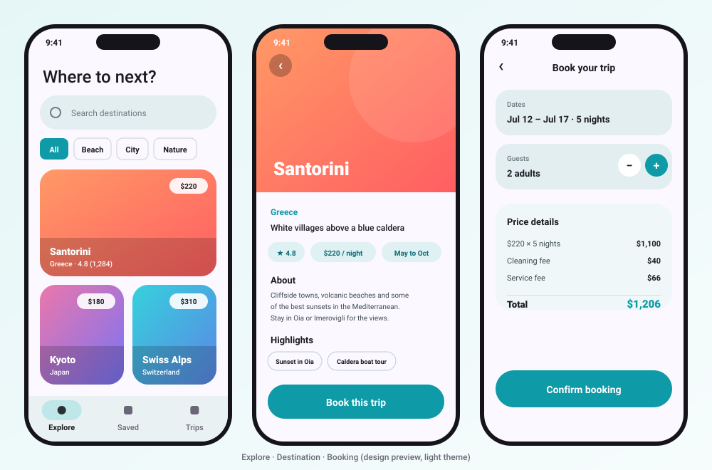

# ✈️ Flutter Travel App

<p align="center"></p>

<sub>Preview: design illustration of the screens, in the light theme. Run the app to see the real thing.</sub>

A free Flutter template for a travel booking app: explore destinations with search and filters, a detail page with hero transition, a booking flow with date range, guests and room type, saved places and your trips. Material 3, light and dark themes, **no third-party packages**.

## Features

- **Explore**: Material 3 `SearchAnchor` with live suggestions, filter chips by vibe, featured carousel, popular list
- **Destination page**: collapsing header with a `Hero` transition, highlights, best time to visit, reviews, sticky price and "Book now"
- **Booking**: date range picker, guest stepper, room type (Standard, Deluxe, Suite) and a live price breakdown (nights, taxes, service fee)
- **Saved**: tap the heart anywhere; the list updates everywhere
- **Trips**: your bookings with dates, guests, total and a cancel option. A success screen takes you straight to them
- **Adaptive**: bottom bar on phones, navigation rail on tablets, desktop and web
- Light and dark themes generated from one seed color. Artwork is an emoji on a gradient, so there are no image assets

## Modern Flutter / Dart used

- Dart 3: records and typedef records (`Quote`), enhanced enums (`Vibe`, `RoomType`)
- Material 3: `SearchAnchor.bar`, `NavigationBar`, `NavigationRail`, `SliverAppBar.large`, `SegmentedButton`, `IconButton.filledTonal`, `ChoiceChip`
- `Color.withValues` and `surfaceContainer*` roles (no deprecated APIs)
- Predictive back transitions on Android
- State with a plain `ChangeNotifier` exposed by a tiny `Scope` (`InheritedNotifier`), injectable clock for tests

## Run it

```bash
flutter create . --platforms=android,ios,web
flutter pub get
flutter run
```

`flutter create .` only adds the platform folders. It keeps the `lib/` and `pubspec.yaml` of this repo. Needs Flutter 3.32 or newer.

## Structure

| Path | Purpose |
|---|---|
| `lib/main.dart` | App entry, theme and store |
| `lib/core/` | Theme, formatting, `Scope`, shared widgets (`DestinationArt`, tiles) |
| `lib/data/models.dart` | `Destination`, `Trip`, `Vibe`, `RoomType`, `Quote` |
| `lib/data/destinations.dart` | Sample catalog (8 destinations) |
| `lib/data/travel_store.dart` | Favorites, trips, search and pricing |
| `lib/features/` | One folder per screen: explore, detail, booking, saved, trips |
| `test/widget_test.dart` | Store logic and UI tests |

## Make it yours

1. Change `brand` in `lib/core/theme.dart` and the name in `lib/main.dart`.
2. Edit `lib/data/destinations.dart`. Swap `DestinationArt` for `Image.network` or `Image.asset` when you have photos (keep the `Hero` around it).
3. Pricing rules live in `TravelStore.quote`.
4. Connect your backend: load destinations in the store and send the booking inside `TravelStore.book`.
5. Prefer Riverpod or Bloc? Replace `Scope` and `TravelStore`; the widgets read state in one line each.

## Notes

- Everything is a demo. No payment is taken, nothing is sent anywhere and data is kept in memory only. Destinations, prices and reviews are fictional.
- This code was written without a Flutter SDK available, so it has not been compiled yet. Run `flutter analyze` and `flutter test` first. If you hit an error, please open an issue.

## License

MIT. Use it for personal and commercial projects.
